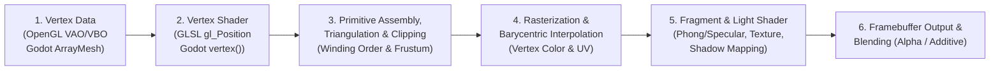

# Peta Kurikulum Komputer Grafis (RPS CIF65116 & 9 Topik Sumanta Guha: Teori OpenGL $\leftrightarrow$ Implementasi Godot 4.7.2 Vulkan)

> **Tujuan Dokumen:** Menjembatani secara eksak teori mata kuliah **Komputer Grafis (CIF65116 — 2 SKS)** yang diajarkan berbasis **OpenGL** (mengacu pada buku *Computer Graphics Through OpenGL: From Theory to Experiments* oleh **Sumanta Guha**, `https://www.sumantaguha.com/`) dengan implementasi nyata pada bagian tugas **Yusuf (Tower & Combat System)** menggunakan **Godot Engine 4.7.2 Stable (Backend Vulkan `Forward+`)**.

---

## 1. Mengapa Penggunaan Vulkan di Godot 4.7.2 Tidak Mengganggu Target Kurikulum OpenGL?

Secara arsitektur perangkat keras GPU modern, **OpenGL 3.3/4.x** dan **Vulkan 1.3** (yang digunakan oleh renderer `Forward+` Godot 4.7.2) mengeksekusi **tahapan *Programmable Graphics Pipeline* yang sama persis**:



Perbedaan utamanya hanyalah: di OpenGL murni (C++), programmer memanggil `glGenBuffers()`, `glBindBuffer()`, dan `glVertexAttribPointer()` secara manual ke driver, sedangkan di **Godot 4.7.2 (Vulkan)**, programmer menyusun buffer vertex, normal, warna, UV, dan indeks triangulasi yang sama melalui **`ArrayMesh` (`SurfaceTool` / `Mesh.ARRAY_*`)** dan **`ImmediateMesh`**, lalu memprogram GPU secara langsung menggunakan **Godot Shading Language (`.gdshader`)** yang sintaksnya merujuk langsung pada **GLSL ES 3.0 / GLSL 4.50**.

Dengan merancang fitur visual dan kalkulasi di dalam modul **Tower & Combat System** menggunakan `ArrayMesh`, `ImmediateMesh`, matriks `Transform3D`/`Basis`, dan `.gdshader`, seluruh target **CPMK-1**, **CPMK-2**, **8 Bahan Kajian RPS**, dan **9 Topik Sumanta Guha** tercapai **100% secara alami di dalam gameplay normal** tanpa perlu membuat mode debug terpisah.

---

## 2. Pemetaan 9 Topik Kuliah (Sumanta Guha) ke Kode Modul Yusuf (`Tower & Combat`)

Tabel berikut memetakan ke-9 topik perkuliahan Anda (beserta bab buku Sumanta Guha) langsung ke fitur gameplay, file script/shader milik Yusuf, dan konsep OpenGL $\leftrightarrow$ Vulkan-nya:

| No | Topik Perkuliahan & Jadwal | Referensi Buku Sumanta Guha | Konsep Teori OpenGL | Padanan API Godot 4.7.2 (Vulkan) | Wujud Alami di Gameplay Modul Yusuf (`res://src/combat/`) |
| :-: | :--- | :--- | :--- | :--- | :--- |
| **1** | **Orthographic Projection, Viewing Box, dan World Coordinates** | **Bab 2** (*On To OpenGL and 3D Computer Graphics*) | `glOrtho()`, Viewing Volume $[l,r]\times[b,t]\times[n,f]$, transformasi koordinat objek lokal ke *World Space*. | `Node3D.global_position`, `Node3D.to_global()`, `Camera3D` Frustum, & Proyeksi Orthographic Light pada *Directional Shadow Map*. | Posisi menara, musuh, dan proyektil dihitung di **World Coordinates $(X, Y, Z)$** menggunakan rumus jarak Euclidean 3D (`combat_math.gd`) dengan skala konversi `UNIT_SCALE = 0.1`. |
| **2** | **Clipping, Color, Primitives, Curved Object, 3D** | **Bab 2 & Bab 10** (*Geometric Primitives, 3D & Depth Buffer*) | Primitif `GL_LINES`, `GL_TRIANGLES`, `GL_TRIANGLE_STRIP`, pendekatan kurva lingkaran dengan segmen poligon $N$-sisi, *Z-Buffer* (`GL_DEPTH_TEST`), dan frustum clipping. | `Mesh.PRIMITIVE_TRIANGLES`, `Mesh.PRIMITIVE_TRIANGLE_STRIP`, atribut `COLOR` (`Color(r,g,b,a)`), dan `depth_draw_opaque` / Z-test. | **Indikator Jangkauan Menara (Curved Ring 3D)** & **Gelombang Ledakan AoE Cannon (Curved Disc 3D)** yang didekati dengan poligon melingkar $N=48$ segmen (`procedural_mesh_builder.gd`). |
| **3** | **Vertex Array, Vertex Buffer, Mouse** | **Bab 3** (*An OpenGL Toolbox: VAs, VBOs, & Mouse Interaction*) | `glEnableClientState(GL_VERTEX_ARRAY)`, `glGenBuffers()` (VBO), `glDrawElements()`, dan *Mouse Picking / Unproject* kursor 2D layar ke ruang 3D. | `ArrayMesh.add_surface_from_arrays()` (`ARRAY_VERTEX`, `ARRAY_NORMAL`, `ARRAY_COLOR`, `ARRAY_TEX_UV`, `ARRAY_INDEX`) & `CollisionObject3D._input_event()` / `PhysicsRayQueryParameters3D`. | 1. **VBO/VAO:** `ArrayMesh` membangun buffer vertex + index di VRAM Vulkan untuk cincin range menara (`procedural_mesh_builder.gd`).<br>2. **Mouse:** Klik mouse pada menara 3D memicu raycast collision & sinyal `tower_selected` (`tower_3d.gd`). |
| **4** | **Transformation & Animation** | **Bab 4, 5, & 6** (*Transformation, Animation, Homogeneous Coords*) | Matriks translasi $T$, rotasi $R_y(\theta) R_x(\phi)$, skala $S$, komposisi matriks $M = T \cdot R \cdot S$, dan *idle/timer animation loop* berbasis $\Delta t$. | `Transform3D` ($3\times 4$ matrix), `Basis` ($3\times 3$ rotation/scale matrix), `Basis.slerp()`, dan `delta` pada `_process(delta)`. | 1. **Rotasi Matriks 3D:** Kepala menara (`TurretHead`) berotasi mulus menghadap musuh menggunakan perhitungan vektor arah & matriks `Basis` (`combat_math.gd` & `tower_3d.gd`).<br>2. **Animasi $\Delta t$:** Translasi proyektil per frame $\mathbf{p}_{t+\Delta t} = \mathbf{p}_t + \mathbf{v}\cdot \Delta t$ (`projectile_3d.gd`). |
| **5** | **Convexity & Interpolation** | **Bab 7** (*Convexity and Interpolation*) | Himpunan konveks (*convex polygon*) dan **Barycentric Interpolation** atribut warna/UV di antara 3 titik sudut segitiga saat rasterisasi. | Atribut `Mesh.ARRAY_COLOR` per-vertex pada `ArrayMesh` dan interpolasi variabel `COLOR` / `UV` dari `vertex()` ke `fragment()` di `.gdshader`. | **Gradasi Radial Cincin Range & Shockwave AoE:** Vertex bagian dalam diberi alpha transparan (`inner_color`), sedangkan vertex tepi luar diberi warna neon tegas (`outer_color`); GPU melakukan interpolasi barycentric secara mulus (`range_ring_blend.gdshader`). |
| **6** | **Triangulation & Orientation** | **Bab 8 & Bab 9** (*Triangulation & Geometric Orientation*) | Partisi poligon menjadi jaring segitiga (*triangle mesh*) dan aturan **Winding Order (CCW/CW)** untuk menentukan vektor normal permukaan ($\mathbf{n} = (\mathbf{v}_1 - \mathbf{v}_0) \times (\mathbf{v}_2 - \mathbf{v}_0)$) serta *Back-Face Culling*. | Penyusunan `PackedInt32Array` (`ARRAY_INDEX`) dengan orientasi sudut konsisten (2 segitiga $(i_0, i_1, i_2)$ dan $(i_2, i_1, i_3)$ per segmen cincin) dan mode `cull_back` / `cull_disabled`. | Fungsi `build_range_ring_mesh()` dan `build_aoe_shockwave_disc()` di `procedural_mesh_builder.gd` menyusun indeks triangulasi secara eksplisit beserta perhitungan vektor normal ke atas (`Vector3.UP`). |
| **7** | **Modeling (20/10)** | **Bab 10** (*Modeling in 3D Space*) | Pemodelan hierarkis (*Hierarchical Modeling / Scene Graph*: Base $\rightarrow$ Turret Head $\rightarrow$ Muzzle Point) dan permukaan parametrik/ekstrusi. | Hierarki `Node3D` (`TowerBase` $\rightarrow$ `TurretHead` $\rightarrow$ `MuzzleMarker3D` $\rightarrow$ `LaserBeamRenderer`) serta pemodelan pita sinar via `ImmediateMesh`. | Struktur hierarkis 3D pada ke-4 jenis Tower (`tower_3d.gd`) dan pembentukan pita sinar 3D real-time pada `Laser Tower` (`laser_beam_renderer.gd`). |
| **8** | **Color & Light (27/10)** | **Bab 11** (*Color and Light*) | Model refleksi cahaya **Phong / Blinn-Phong** (*Ambient + Lambertian Diffuse $\max(\mathbf{N}\cdot\mathbf{L}, 0)$ + Specular $\max(\mathbf{N}\cdot\mathbf{H}, 0)^s$*) dan properti material/emisi. | Custom `shader_type spatial` dengan fungsi `fragment()` dan `light()` (`DIFFUSE_LIGHT`, `SPECULAR_LIGHT`, `EMISSION`, `NORMAL`, `LIGHT`, `VIEW`). | **`freeze_crystal_phong.gdshader`:** Digunakan pada efek es `Freeze Tower` (saat musuh terkena slow) dan inti energi menara, menghitung *Diffuse*, *Blinn-Phong Specular*, dan *Fresnel Rim Lighting* secara eksplisit di GPU. |
| **9** | **Texture (3/11)** | **Bab 12** (*Texture*) | Pemetaan koordinat tekstur 2D $(u, v) \in [0, 1]^2$ ke permukaan 3D, *texture wrapping (`GL_REPEAT`)*, filtering, dan transformasi matriks UV. | `uniform sampler2D`, atribut `UV` di `ARRAY_TEX_UV`, flag `repeat_enable`, `filter_linear_mipmap`, dan pergeseran UV dinamis `UV + vec2(TIME * speed, 0.0)`. | **`laser_beam_scroll.gdshader`:** Memetakan tekstur pulsa energi sepanjang pita `Laser Tower` dan menggeser koordinat $(u, v)$ secara real-time berdasarkan `TIME` untuk menghasilkan efek aliran plasma 3D. |

---

## 3. Pemetaan Bahan Kajian & Sub-CPMK pada RPS (CIF65116)

Selain 9 topik mingguan di atas, lembar RPS **CIF65116 Komputer Grafis** mencantumkan **8 Bahan Kajian** dan **2 Sub-CPMK**. Berikut bukti ketercapaiannya di dalam bagian Yusuf:

### A. Ketercapaian Sub-CPMK
- **CPMK-1 (*Mahasiswa mampu memahami konsep dan model matematis dalam grafika komputer dan menghasilkan simulasi grafika komputer secara waktu nyata*):**
  - Dibuktikan melalui modul [`res://src/combat/math/combat_math.gd`](file:///home/helloohowareyu/Documents/Computer%20Graphics/cyber_defense/docs/00_YUSUF_MASTER_PLAN.md) (perhitungan jarak Euclidean 3D, transformasi matriks `Basis` rotasi menara, vektor arah proyektil real-time berbasis `delta`, dan algoritma triangulasi parametrik lingkaran 3D di `procedural_mesh_builder.gd`).
- **CPMK-2 (*Mahasiswa mampu mengaplikasikan teknik rendering 3D berbasis programmable pipeline/shader untuk menghasilkan simulasi grafika komputer secara waktu nyata*):**
  - Dibuktikan melalui 3 program shader khusus di [`res://src/combat/shaders/`](file:///home/helloohowareyu/Documents/Computer%20Graphics/cyber_defense/docs/00_YUSUF_MASTER_PLAN.md) (`range_ring_blend.gdshader`, `laser_beam_scroll.gdshader`, dan `freeze_crystal_phong.gdshader`) yang mengimplementasikan *Vertex Shader*, *Fragment Shader*, dan *Custom Light Shader*.

### B. Ketercapaian Bahan Kajian 7 (*Shadow Mapping*) & 8 (*Blending*)
1. **Bahan Kajian 7 — Shadow Mapping:**
   - Pada mesh menara (`Tower3D`) dan proyektil (`Projectile3D`), properti `cast_shadow = GeometryInstance3D.SHADOW_CASTING_SETTING_ON` diaktifkan agar objek di modul Combat merender kedalaman (*depth map*) ke *Shadow Map* lampu utama (`DirectionalLight3D` / `OmniLight3D` ledakan), sementara indikator jangkauan di tanah diatur `SHADOW_CASTING_SETTING_OFF` agar tidak menimbulkan bayangan palsu.
2. **Bahan Kajian 8 — Blending:**
   - Diterapkan melalui dua persamaan *blending* klasik OpenGL di dalam shader modul Combat:
     - **Alpha Blending (`render_mode blend_mix` $\equiv$ `glBlendFunc(GL_SRC_ALPHA, GL_ONE_MINUS_SRC_ALPHA)`):** Digunakan pada `range_ring_blend.gdshader` untuk cincin jangkauan menara dan indikator AoE `Cannon Tower` agar lantai peta di bawahnya tetap terlihat transparan.
     - **Additive Blending (`render_mode blend_add` $\equiv$ `glBlendFunc(GL_SRC_ALPHA, GL_ONE)`):** Digunakan pada `laser_beam_scroll.gdshader` untuk sinar `Laser Tower` agar warna energi menyala terang (*glowing plasma*) ketika bertumpuk dengan latar 3D.

---

## 4. Contoh Kode Konkret: VAO/VBO & Triangulasi di Godot 4 (`ProceduralMeshBuilder`)

Sebagai panduan langsung saat implementasi **Task 4**, berikut adalah pola kode pembentukan cincin 3D menggunakan `ArrayMesh` yang menggabungkan **Topik 2 (Curved Object), Topik 3 (Vertex Array/VBO), Topik 5 (Interpolation), dan Topik 6 (Triangulation & Orientation)**:

```gdscript
## Membangun mesh cincin 3D (Annulus) di bidang XZ menggunakan ArrayMesh (padanan VAO/VBO OpenGL).
## [FUNGSI]:
##   Menghasilkan buffer posisi vertex, normal, UV, warna vertex (untuk interpolasi barycentric),
##   dan index buffer triangulasi ber-orientasi Counter-Clockwise (CCW) dilihat dari atas (+Y).
## [REFERENSI_KURIKULUM]:
##   - Sumanta Guha Bab 2 (Curved Object Approximation), Bab 3 (Vertex Array & VBO),
##     Bab 7 (Barycentric Color Interpolation), Bab 8 & 9 (Triangulation & Winding Orientation).
## [ARAH_INTERAKSI]:
##   - Dipanggil oleh : `Tower3D._rebuild_range_indicator_mesh()` (`res://src/combat/towers/tower_3d.gd`)
##   - Output ke      : Mengembalikan instance `ArrayMesh` siap pasang ke `MeshInstance3D.mesh`.
static func build_range_ring_mesh(
	inner_radius: float,
	outer_radius: float,
	segments: int,
	inner_color: Color,
	outer_color: Color
) -> ArrayMesh:
	var safe_segments: int = maxi(8, segments)
	var vertices := PackedVector3Array()
	var normals := PackedVector3Array()
	var uvs := PackedVector2Array()
	var colors := PackedColorArray()
	var indices := PackedInt32Array()

	for i: int in range(safe_segments + 1):
		var ratio: float = float(i) / float(safe_segments)
		var angle: float = ratio * TAU
		var cos_a: float = cos(angle)
		var sin_a: float = sin(angle)

		# Vertex Dalam (Inner Ring) - diinterpolasi dengan inner_color
		vertices.append(Vector3(cos_a * inner_radius, 0.02, sin_a * inner_radius))
		normals.append(Vector3.UP)
		uvs.append(Vector2(ratio, 0.0))
		colors.append(inner_color)

		# Vertex Luar (Outer Ring) - diinterpolasi dengan outer_color
		vertices.append(Vector3(cos_a * outer_radius, 0.02, sin_a * outer_radius))
		normals.append(Vector3.UP)
		uvs.append(Vector2(ratio, 1.0))
		colors.append(outer_color)

	# Penyusunan Index Buffer Triangulasi (2 segitiga per segmen quad)
	for i: int in range(safe_segments):
		var base_idx: int = i * 2
		# Segitiga 1: (Inner_i, Outer_i, Inner_{i+1})
		indices.append(base_idx)
		indices.append(base_idx + 1)
		indices.append(base_idx + 2)
		# Segitiga 2: (Inner_{i+1}, Outer_i, Outer_{i+1})
		indices.append(base_idx + 2)
		indices.append(base_idx + 1)
		indices.append(base_idx + 3)

	var surface_arrays: Array = []
	surface_arrays.resize(Mesh.ARRAY_MAX)
	surface_arrays[Mesh.ARRAY_VERTEX] = vertices
	surface_arrays[Mesh.ARRAY_NORMAL] = normals
	surface_arrays[Mesh.ARRAY_TEX_UV] = uvs
	surface_arrays[Mesh.ARRAY_COLOR] = colors
	surface_arrays[Mesh.ARRAY_INDEX] = indices

	var mesh := ArrayMesh.new()
	mesh.add_surface_from_arrays(Mesh.PRIMITIVE_TRIANGLES, surface_arrays)
	return mesh
```
