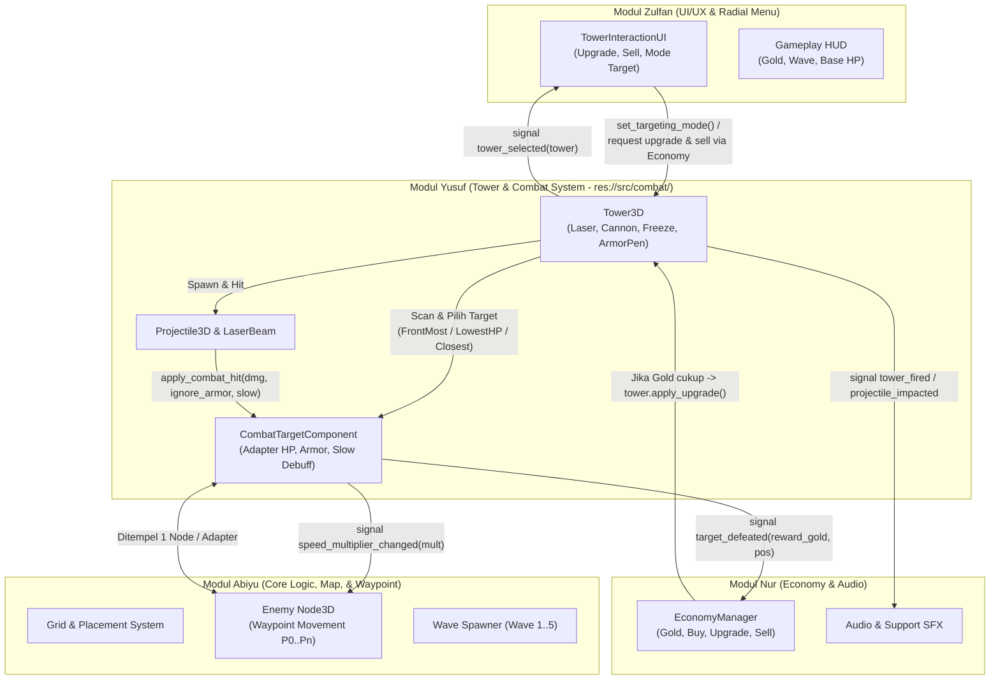

# Kontrak Integrasi & Adapter Pattern Lintas Anggota Tim (`CYBER DEFENSE`)

> **Tujuan Dokumen:** Menetapkan batas tanggung jawab kode (*surgical boundary*) dan kontrak komunikasi (`Signal` & `Adapter Method`) antara modul **Yusuf (`Tower & Combat System`)** dengan modul **Abiyu (`Core Game Logic & Enemy Movement`)**, **Nur (`Economy, Upgrade/Sell, & Audio`)**, serta **Zulfan (`UI/UX & Radial Menu`)** agar modul Yusuf dapat dikerjakan dan diuji 100% secara mandiri sekarang juga, sekaligus siap di-*plug-and-play* begitu kode anggota tim lain digabungkan.

---

## 1. Peta Interaksi Empat Modul Tim (`Call Down, Signal Up`)



---

## 2. Strategi Antisipasi Kode Abiyu (`Adapter Pattern` Tanpa Mengubah Kode Inti Abiyu)

Karena **Abiyu sudah mulai mengerjakan *Core Game Logic* (termasuk pergerakan musuh di jalur waypoint)** namun kita belum memegang akses kode programnya saat ini, kita **tidak boleh** menulis logika Tower yang bergantung pada nama variabel internal di script milik Abiyu.

Sebagai solusinya, kita menggunakan **`CombatTargetComponent` (`res://src/combat/components/combat_target_component.gd`)** dengan mekanisme **Dual-Mode Adapter**:

### A. Cara Kerja `CombatTargetComponent`
1. **Dimasukkan ke Grup Godot `"combat_targets"` secara otomatis saat `_ready()`:**
   - `Tower3D` cukup mencari target yang terdaftar di grup `"combat_targets"` atau yang berada di dalam `Area3D`, tanpa peduli apa nama class root musuh buatan Abiyu (`Enemy.gd`, `Goblin.gd`, `PathFollow3D`, atau `CharacterBody3D`).
2. **Sinkronisasi Posisi & Kemajuan Jalur (`FRONT_MOST` Targeting):**
   - Untuk mode `FRONT_MOST` (menyerang musuh yang paling dekat dengan Energy Core), `TargetSelector` membaca `get_path_progress_score()` pada `CombatTargetComponent`:
     - Jika Abiyu menggunakan `PathFollow3D`, adapter otomatis membaca `parent.progress`.
     - Jika Abiyu menggunakan indeks waypoint (`current_waypoint_index`) dan posisi 3D, adapter otomatis membaca properti tersebut atau menghitung jarak negatif ke posisi `Energy Core` ($-d(\text{pos}_{\text{enemy}}, \text{pos}_{\text{core}})$).
3. **Sinkronisasi Efek Slow (`Freeze Tower` - `40%` Slow selama `2.5s`) dan Kematian Musuh:**
   - Saat musuh terkena serangan `Freeze Tower`, `CombatTargetComponent` memancarkan `signal speed_multiplier_changed(0.6)` **DAN** secara opsional memeriksa `if get_parent().has_method("set_speed_multiplier"):` (duck-typing aman).
   - Saat HP mencapai `0`, `CombatTargetComponent` memancarkan `signal target_defeated(reward_gold, global_position)` untuk modul Ekonomi (Nur) dan Wave Manager (Abiyu).

### B. Langkah Integrasi 3 Menit Saat Kode Abiyu Tersedia
Begitu repositori Abiyu digabungkan, kita hanya perlu melakukan **salah satu** dari dua hal ringan berikut (kurang dari 5 baris kode):
- **Opsi 1 (Zero-Code di Scene Editor):** Tambahkan node `CombatTargetComponent` sebagai *child node* pada scene musuh buatan Abiyu (`Goblin.tscn`, `Orc.tscn`, `Harpy.tscn`, `DemonKing.tscn`) dan hubungkan 2 sinyalnya (`speed_multiplier_changed` dan `target_defeated`).
- **Opsi 2 (Duck-Typing Hook):** Jika Abiyu sudah membuat variabel `hp` dan fungsi `take_damage()` sendiri di script musuhnya, `CombatTargetComponent` langsung meneruskan hasil `CombatMath.calculate_final_damage()` ke fungsi milik Abiyu tersebut.

---

## 3. Kontrak dengan Modul Nur (`Economy & Supporting System`)

Sesuai GDD Bagian 4.5, 5, 8, dan 14, **Nur** mengelola saldo Gold pemain, validasi pembelian/upgrade/penjualan menara, serta efek suara (SFX). Agar tidak terjadi duplikasi perhitungan:

### A. Fungsi Publik di `Tower3D` yang Disediakan Yusuf untuk Dipanggil Modul Nur
```gdscript
## Mengembalikan biaya Gold untuk naik ke level berikutnya: ceil(base_cost * 1.5^level).
## Mengembalikan 0 jika sudah mencapai MAX_LEVEL (3).
func get_next_upgrade_cost() -> int

## Mengembalikan true jika current_level < 3.
func can_upgrade() -> bool

## Dipanggil oleh EconomyManager (Nur) SETELAH Gold pemain berhasil dipotong.
## Menaikkan current_level (+1), menambah total_invested_gold, meng-update Damage (+25%) & Range (+10%),
## serta memperbarui ukuran mesh Range Ring secara otomatis.
func apply_upgrade() -> bool

## Mengembalikan jumlah Gold jika menara dijual saat ini: floor(total_invested_gold * 0.7).
func get_sell_refund_gold() -> int
```

### B. Sinyal dari Modul Yusuf yang Didengar oleh Modul Nur (Audio & Economy)
| Asal Node (Yusuf) | Nama Sinyal & Parameter | Tujuan di Modul Nur |
| :--- | :--- | :--- |
| `CombatTargetComponent` | `target_defeated(reward_gold: int, world_pos: Vector3)` | Menambahkan `reward_gold` (`15`/`25`/`20`/`150` Gold) ke saldo pemain & memutar SFX musuh hancur. |
| `Tower3D` | `tower_fired(tower: Tower3D, target: CombatTargetComponent, damage: float)` | Memutar SFX tembakan sesuai jenis menara (`LASER`, `CANNON`, `FREEZE`, `ARMOR_PEN`). |
| `Tower3D` | `tower_upgraded(tower: Tower3D, new_level: int, total_invested: int)` | Memutar SFX upgrade berhasil. |
| `Projectile3D` | `projectile_impacted(world_pos: Vector3, is_aoe: bool)` | Memutar SFX ledakan AoE Cannon atau benturan proyektil. |

---

## 4. Kontrak dengan Modul Zulfan (`UI/UX & Tower Interaction Menu`)

Sesuai GDD Bagian 9.3, ketika pemain mengklik menara di peta, muncul **Tower Interaction Menu (Radial Menu)** yang menampilkan nama, level, damage, range, tombol Upgrade, tombol Sell, dan pilihan mode targeting (`Front Most`, `Lowest HP`, `Closest`).

### Fungsi & Sinyal di `Tower3D` untuk UI Zulfan:
1. **Saat Menara Diklik Mouse di Ruang 3D:**
   - `Tower3D` mendeteksi klik kiri mouse pada collider-nya, menyalakan cincin indikator jangkauan (`set_range_indicator_visible(true)`), dan memancarkan:
     `signal tower_selected(tower_instance: Tower3D)`
2. **Data yang Dapat Dibaca Langsung oleh UI Zulfan dari `tower_instance`:**
   - `tower_instance.get_ui_summary() -> Dictionary`:
     Mengembalikan dictionary lengkap yang siap ditampilkan di label UI tanpa Zulfan perlu menghitung rumus lagi:
     ```gdscript
     {
         "display_name": "Laser Tower",
         "level": 1,
         "max_level": 3,
         "current_damage": 15.0,
         "current_range_gdd": 150.0,
         "fire_rate_sec": 0.5,
         "targeting_mode": TargetSelector.Mode.FRONT_MOST,
         "can_upgrade": true,
         "next_upgrade_cost": 150,
         "sell_refund_gold": 70
     }
     ```
3. **Mengubah Mode Targeting dari Tombol UI Zulfan:**
   - UI Zulfan cukup memanggil:
     `tower_instance.set_targeting_mode(TargetSelector.Mode.LOWEST_HP)` (atau `FRONT_MOST` / `CLOSEST`).
4. **Menutup Menu Interaksi:**
   - Saat pemain mengklik area kosong atau menutup menu, UI Zulfan memanggil `tower_instance.set_range_indicator_visible(false)`.

---

## 5. Checklist Kesiapan Pra-Integrasi Tim

Sebelum menggabungkan branch `feat/yusuf-tower-combat` ke branch `main` bersama Zulfan, Abiyu, dan Nur:
- [ ] Seluruh test di `res://tests/combat/test_combat_system.gd` berstatus **PASS**.
- [ ] Seluruh file di `res://src/combat/` berada di dalam foldernya sendiri dan tidak menimpa file di luar `src/combat/`.
- [ ] `CombatSandbox.tscn` berjalan mulus di Godot 4.7.2 Stable tanpa error merah di tab *Debugger*.
- [ ] Setiap fungsi dan class sudah memiliki blok komentar `## [FUNGSI]`, `## [REFERENSI_KURIKULUM]`, dan `## [ARAH_INTERAKSI]`.
